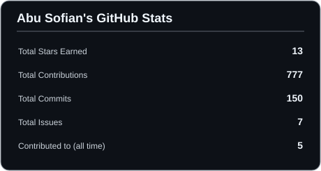
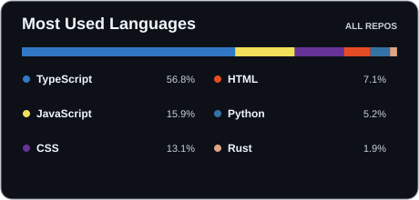

I'm passionate about **data and design** — I enjoy turning messy numbers into clear stories and exploring how tech can solve real problems. I like to keep learning, experimenting, and sharing what I find along the way.

- **Currently exploring:** Data Analytics, AI & Creative Design
- **Love connecting with:** data enthusiasts, developers, and fellow creatives
- **Let's talk about:** data, visualization, design, or just cool tech ideas
- **Outside of work:** you'll catch me watching movies, enjoying music, or reading

---

### Frameworks & Runtimes

---

### Languages & Web Technologies

---

### Tools & Environment

---

### Stats Summary

